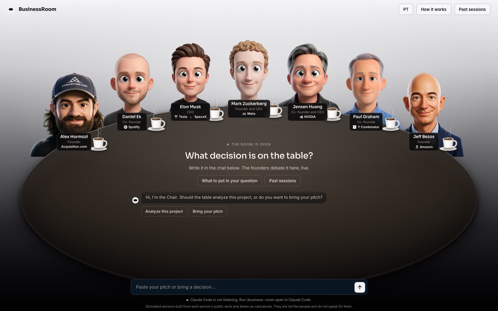

# BusinessRoom



Bring a hard startup decision to a table of simulated founders. They argue it out live in a local room, then hand you a scored verdict and a one-click PDF. Each seat is built from that person's public work: letters, essays, talks, and interviews.

BusinessRoom is a Claude Code plugin. Install it once, type one command, and the room opens in your browser.

> Work in progress. The v1 scope is in [docs/SCOPE.md](docs/SCOPE.md). Portraits for the four new founders are not drawn yet; the room shows their initials until they are.

| Seat | Pillar | The question they own |
|---|---|---|
| Jeff Bezos | Strategy and decisions | Is this the right bet, and how reversible is it? |
| Paul Graham | Product and startups | Do people actually want this, and is it growing? |
| Alex Hormozi | Offers, pricing, metrics, and cash | Will people pay, do the unit economics work, and does the cash last? |
| Elon Musk | First principles and execution | What do physics and cost really allow, and how fast can this ship? |
| Mark Zuckerberg | Growth and scale | Does this grow on its own, and how fast are we learning? |
| Jensen Huang | Long bets and market creation | Does this create a new market, and can the company endure until it pays? |
| Daniel Ek | Distribution and business model | How does this reach millions, and does the revenue model hold up? |

## What you need

- [Claude Code](https://claude.com/claude-code). Your Claude plan covers it; no API key needed.
- [Node.js](https://nodejs.org) 20 or newer, for the room. Nothing else to install.

## Install

In Claude Code:

```
/plugin marketplace add rodrigoscharp/BusinessRoom
/plugin install business-room@business-room
```

Restart Claude Code (or run `/reload-plugins`) so the new skill and agents load.

## Use

```
/business-room open
```

Claude starts the room, opens it in your browser, and listens to the chat box under the table. Write your decision there; the Chair asks its questions in the same chat, and the founders debate it live at the table.

The Chair first asks whether the table should **analyze this project** (it reads the README and docs of the project open in Claude Code and frames how to sell it, grow it, and turn it into a startup) or **take a new case** you describe. The room has an English and a Portuguese mode (the PT / EN button at the top); the founders answer in the room's language.

You can also give the decision straight in Claude Code:

```
/business-room I run a B2B SaaS at R$8k MRR with 40 customers at R$200 a month.
Should I raise to R$250 for everyone, for new customers only, or keep R$200?
Churn is about 3% a month and I have 6 months of runway. I'm leaning toward raising for everyone.
```

Answer the Chair's questions, then watch the council argue it out in the room. When the verdict lands, click **Download PDF**.

More ways to run it:

- `/business-room --quick ...` seats four advisors for two rounds. Use it for smaller, reversible calls. It uses far less of your plan.
- `/business-room --seats hormozi,bezos ...` seats only the advisors you name.
- `/business-room ask hormozi ...` gets one answer from one seat.

If Claude Code shows the skill with its plugin prefix, use `/business-room:business-room` instead.

## Where your councils go

Every council is saved in `~/.business-room/sessions/<date>-<decision>/`, with the full report in `verdict.md`. The plugin folder is replaced on every update, so your councils live outside it. Set `BUSINESS_ROOM_HOME` to keep them somewhere else.

The room runs at http://localhost:4740. Set `BUSINESS_ROOM_PORT` if that port is taken.

## What to put in your question

The council is only as good as what you give it. Include:

- **The decision** in one line.
- **Your options.** Two or three. "Keep doing what I do now" counts.
- **Your numbers.** Revenue, customers, churn, cash, and team size.
- **Your limits.** Deadline, hours, and budget.
- **What success looks like**, and by when.
- **Which way you're leaning**, and why. The council tests your lean instead of agreeing with it.

Left something out? The Chair asks before the council starts.

## How it works

- **The council runs in Claude Code.** Each seat is a sub-agent (`agents/council-*.md`) that reads its own brain (`skills/business-room/brains/<name>/`): frameworks, principles, positions, stories, and voice notes compiled from public sources, with every quote tied to a source. Claude Code acts as the Chair. It runs the rounds, keeps score, and writes the verdict (`skills/business-room/SKILL.md`).
- **Each seat scores every option**, weighted by how much that seat's pillar matters to your decision. The Chair caps the verdict when a seat flags ruin risk, and it forces a real argument when everyone agrees too fast.
- **The room only watches.** As the Chair works, it writes each step to your sessions folder, and the room plays those files back. The room makes no AI calls of its own.
- **Usage:** a full council is 21 sub-agent runs, so it takes a real bite out of your plan's usage. Use `--quick` for small calls.

## Optional: let the room run councils itself

To type a decision straight into the room without Claude Code, create `~/.business-room/.env` with an `ANTHROPIC_API_KEY` and `COUNCIL_RUNNER=api` (see `.env.example`), then restart the room. That mode bills your Anthropic API account (about 25 calls per full council).

## Develop

```bash
git clone https://github.com/rodrigoscharp/BusinessRoom.git
cd BusinessRoom
claude --plugin-dir .
```

`--plugin-dir .` loads this checkout as the plugin, so edits show up after `/reload-plugins`. `npm start` starts and opens the room, `npm stop` stops it, and `claude plugin validate .` checks the manifests.

| Path | What |
|---|---|
| `.claude-plugin/` | Plugin and marketplace manifests |
| `skills/business-room/` | The skill: protocol, prompts, scoring, report template, and the brains |
| `agents/` | The seat agents |
| `app/` | The room: a zero-dependency Node server, the web page, and the PDF builder |
| `sessions/` | Example councils that ship with the plugin (none yet for the new roster) |

## About the advisors

These are simulations built from each person's public work. They are not the people, they don't speak for them, and none of them is affiliated with or endorses this project. A seat only quotes a person verbatim when the line is in its brain with a source, and `python3 skills/business-room/scripts/check_quotes.py <session folder>` checks every quote in a council against the brains. Each brain's `sources.md` lists what it was built from.

## Credits

Built on [Roast Room](https://github.com/nateherkai/roast-room) by AI Automation Society, under the MIT License; see `LICENSE`. BusinessRoom has its own roster, brains, visual identity, and room layout. The PDF builder bundles [jsPDF](https://github.com/parallax/jsPDF) (MIT); its license sits next to it in `app/public/vendor/`. Company logos under the founders' names come from [Simple Icons](https://simpleicons.org) (CC0); the brands belong to their owners.
