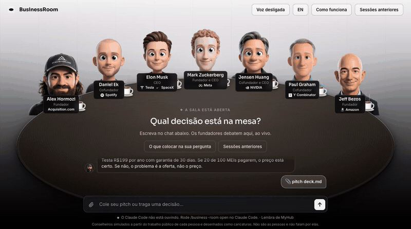

# BusinessRoom


<details><summary>Watch a council play out (Shark Tank, in Portuguese)</summary>



</details>

Bring a hard startup decision to a table of simulated founders. You talk to the table in a chat box under it, the founders argue it out live, and you get a scored verdict and a one-click PDF. Each seat is built from that person's public work: letters, essays, talks, and interviews.

BusinessRoom is a Claude Code plugin. Install it once, type one command, and the room opens in your browser.

## The table

Seats are listed in the order they sit, left to right.

| Seat | Role and company | Pillar | The question they own |
|---|---|---|---|
| Alex Hormozi | Founder, Acquisition.com | Offers, pricing, metrics, and cash | Will people pay, do the unit economics work, and does the cash last? |
| Daniel Ek | Co-founder, Spotify | Distribution and business model | How does this reach millions, and does the revenue model hold up? |
| Elon Musk | CEO, Tesla and SpaceX | First principles and execution | What do physics and cost really allow, and how fast can this ship? |
| Mark Zuckerberg | Founder and CEO, Meta | Growth and scale | Does this grow on its own, and how fast are we learning? |
| Jensen Huang | Co-founder and CEO, NVIDIA | Long bets and market creation | Does this create a new market, and can the company endure until it pays? |
| Paul Graham | Co-founder, Y Combinator | Product and startups | Do people actually want this, and is it growing? |
| Jeff Bezos | Founder, Amazon | Strategy and decisions | Is this the right bet, and how reversible is it? |

Claude Code sits at the head of the table as the **Chair**. The Chair never argues a side. It runs the rounds, keeps the score, and writes the verdict.

## What you need

- [Claude Code](https://claude.com/claude-code). Your Claude plan covers it; no API key needed.
- [Node.js](https://nodejs.org) 20 or newer, for the room. Nothing else to install.

## Install

In Claude Code:

```
/plugin marketplace add rodrigoscharp/BusinessRoom
/plugin install business-room@business-room
```

Restart Claude Code (or run `/reload-plugins`) so the new skill and agents load.

To update later:

```bash
claude plugin marketplace update business-room
```

```bash
claude plugin update business-room@business-room
```

## Use

```
/business-room open
```

Claude starts the room, opens it in your browser, and listens to the chat box under the table. From there you talk to the room, not to the terminal.

The Chair opens with these buttons:

- **Analyze this project.** The Chair reads the README, manifest, and docs of the project open in Claude Code, then the table debates how to sell it, grow it, and turn it into a business.
- **Bring your pitch.** Paste a few lines about your business and the decision you face, or attach a deck with the clip button (PDF, image, or text). The Chair asks a handful of short questions about what is missing (some with reply buttons), and asks how the table should answer: a regular debate, or **Shark Tank**, where each founder says if they are in or out and on what terms. You answer, and all seven founders start.
- **Check in on a decision.** Shows up when a past decision is due. The Chair asks what happened with each next step, judges it against the verdict's own kill criteria, and offers to rerun the council with the new facts.

The founders debate in the middle of the table. You can write while they debate: the Chair brings your message to the table before the next round. When the verdict lands, click **Download PDF** for a branded report, or **Share image** for a 1200×630 picture of the verdict to post.

After the verdict, click any founder and then **Ask** to put one follow-up question to that founder alone. It is one quick run, and the answer comes back in the chat in that founder's voice.

You can also skip the room and give the decision straight in Claude Code:

```
/business-room I run a B2B SaaS at R$8k MRR with 40 customers at R$200 a month.
Should I raise to R$250 for everyone, for new customers only, or keep R$200?
Churn is about 3% a month and I have 6 months of runway. I'm leaning toward raising for everyone.
```

More ways to run it:

- `/business-room --shark ...` runs the council as a Shark Tank: every founder ends with in or out, and their terms.
- `/business-room checkin` follows up on a past decision.
- `/business-room --deep ...` adds a third round where every founder votes on the Chair's draft plan. Use it for calls you cannot undo; it uses far more of your plan.
- `/business-room --seats hormozi,bezos ...` seats only the founders you name. The others stay at the table, greyed out and marked "Not in this council".
- `/business-room ask hormozi ...` gets one answer from one seat.

If Claude Code shows the skill with its plugin prefix, use `/business-room:business-room` instead.

### The Chair remembers your company

After each council, the Chair saves what it learned about your company in `~/.business-room/company.md`: what you sell, your numbers with their dates, and each decision with its next check date. The next time, it uses those numbers and only asks about what changed. The room shows "Remembers <your company>" under the chat. You can read or edit the file any time.

### English and Portuguese

The room has an English and a Portuguese mode: the **PT / EN** button at the top. The Chair and the founders answer in the room's language. The page tells Chrome not to auto-translate it, so text never comes out half translated. To open the room in a set language, add `?lang=en` or `?lang=pt` to the address.

## What happens at the table

- The founder who is speaking moves their mouth, and the others turn their heads toward them.
- **Voice** (top right) reads each founder's lines out loud with your browser's voices. It is off by default.
- In Shark Tank, each founder gets an "I'M IN" or "I'M OUT" stamp as they finish, and the verdict lists every deal.
- Everyone blinks now and then.
- Each founder has a coffee cup. Founders who have been quiet for a while pick it up, close their eyes, and take a sip.
- Under each name sit the founder's role and company logo.
- The **Guide** button explains the room, and **History** reopens past councils.

## What to put in your question

The council is only as good as what you give it. Include:

- **The decision** in one line.
- **Your options.** Two or three. "Keep doing what I do now" counts.
- **Your numbers.** Revenue, customers, churn, cash, and team size.
- **Your limits.** Deadline, hours, and budget.
- **What success looks like**, and by when.
- **Which way you're leaning**, and why. The council tests your lean instead of agreeing with it.

Left something out? The Chair asks in the chat before the council starts.

## Where your councils go

Every council is saved in `~/.business-room/sessions/<date>-<decision>/`, with the full report in `verdict.md`. Next to it in `~/.business-room/` live the chat history (`chat.jsonl`), the company memory (`company.md`), and the files you attach in the chat (`uploads/`). The plugin folder is replaced on every update, so your data lives outside it. Set `BUSINESS_ROOM_HOME` to keep it somewhere else.

The room runs at http://localhost:4740. Set `BUSINESS_ROOM_PORT` if that port is taken. `npm stop` stops it.

## How it works

- **The council runs in Claude Code.** Each seat is a sub-agent (`agents/council-*.md`) that reads its own brain (`skills/business-room/brains/<name>/`): frameworks, principles, positions, stories, and voice notes compiled from public sources, with every quote tied to a source. Claude Code acts as the Chair (`skills/business-room/SKILL.md`).
- **The chat is a bridge.** The page writes your messages to `chat.jsonl`; the Chair reads them with `app/scripts/chat.mjs wait` and replies with `say` or `ask`. No message leaves your machine except through Claude Code itself.
- **Each seat scores every option**, weighted by how much that seat's pillar matters to your decision. The Chair caps the verdict when a seat flags ruin risk, and it forces a real argument when everyone agrees too fast.
- **The room only plays the council back.** As the Chair works, it writes each round to your sessions folder, and the room plays those files as they land. The room makes no AI calls of its own.
- **Usage:** every council seats all seven founders. To keep it light on your plan, the default council runs two rounds (14 seat runs), the seats run on Sonnet with short cards, and each seat reads only a few files of its brain. `--deep` runs three rounds on Opus (21 runs) and costs several times more. The verdict shows how many seat runs the council took and on which model. [docs/MODEL-TEST.md](docs/MODEL-TEST.md) compares Sonnet and Opus on the same case: same call, same scores within 2 points.

## Optional: let the room run councils itself

To run councils without Claude Code, create `~/.business-room/.env` with an `ANTHROPIC_API_KEY` and `COUNCIL_RUNNER=api` (see `.env.example`), then restart the room. That mode bills your Anthropic API account (about 25 calls per full council).

## Develop

```bash
git clone https://github.com/rodrigoscharp/BusinessRoom.git
cd BusinessRoom
claude --plugin-dir .
```

`--plugin-dir .` loads this checkout as the plugin, so edits show up after `/reload-plugins`. `npm start` starts and opens the room, `npm stop` stops it, `npm run smoke` tests API mode (it needs `ANTHROPIC_API_KEY`), and `claude plugin validate .` checks the manifests.

| Path | What |
|---|---|
| `.claude-plugin/` | Plugin and marketplace manifests |
| `skills/business-room/` | The skill: protocol, prompts, scoring, report template, and the brains |
| `agents/` | The seat agents |
| `app/server.mjs`, `app/lib/` | The room server (zero dependencies) and the chat bridge |
| `app/public/` | The page: table, chat, portraits, logos, PT/EN strings, the PDF builder, and the share image (`share.js`) |
| `app/scripts/` | `open-room.mjs`, `chat.mjs`, and the portrait tools |
| `docs/` | Scope, the portrait guide ([docs/PORTRAITS.md](docs/PORTRAITS.md)), the model test ([docs/MODEL-TEST.md](docs/MODEL-TEST.md)), the screenshot, and the demo GIF |

## About the advisors

These are simulations built from each person's public work. They are not the people, they don't speak for them, and none of them is affiliated with or endorses this project. A seat only quotes a person verbatim when the line is in its brain with a source, and `python3 skills/business-room/scripts/check_quotes.py <session folder>` checks every quote in a council against the brains. Each brain's `sources.md` lists what it was built from. The portraits are cartoon illustrations, not photos.

## Credits

Built on [Roast Room](https://github.com/nateherkai/roast-room) by AI Automation Society, under the MIT License; see `LICENSE`. BusinessRoom has its own roster, brains, visual identity, chat, and room layout. The PDF builder bundles [jsPDF](https://github.com/parallax/jsPDF) (MIT); its license sits next to it in `app/public/vendor/`. Company logos under the founders' names come from [Simple Icons](https://simpleicons.org) (CC0); the brands belong to their owners.
